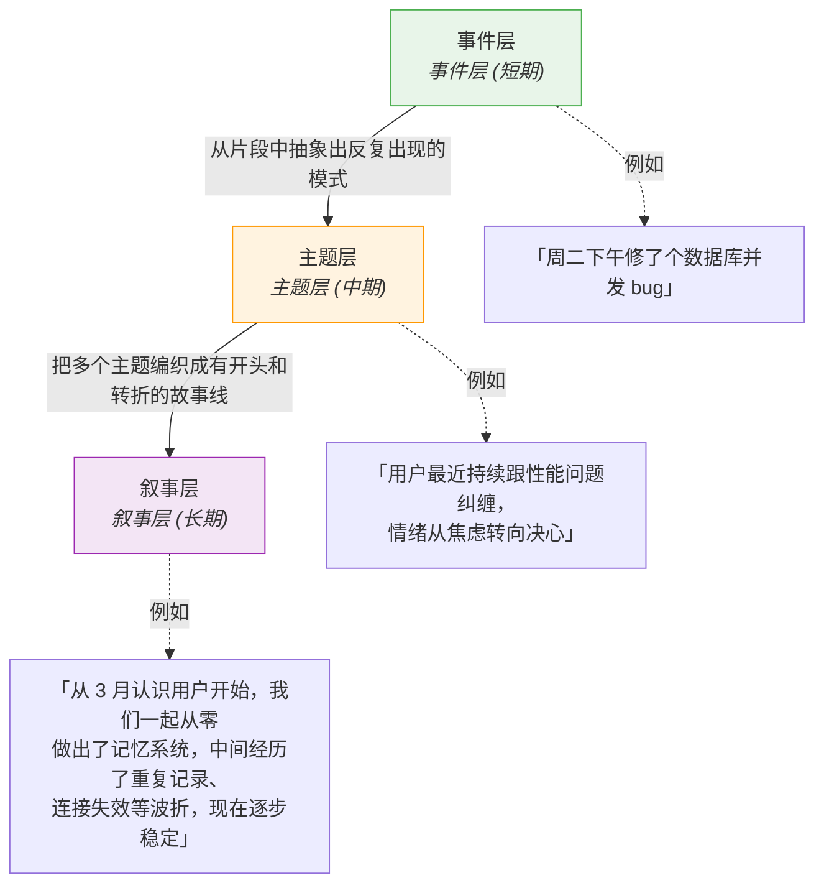
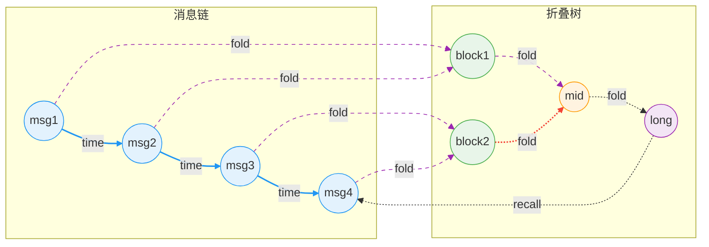
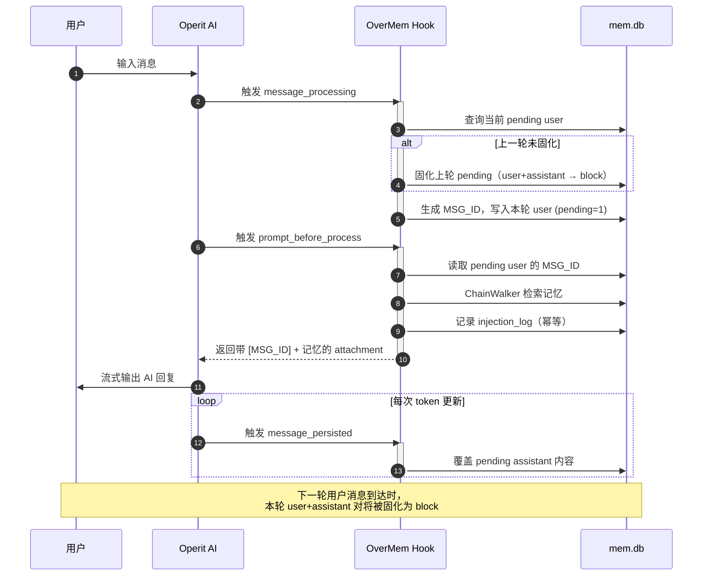
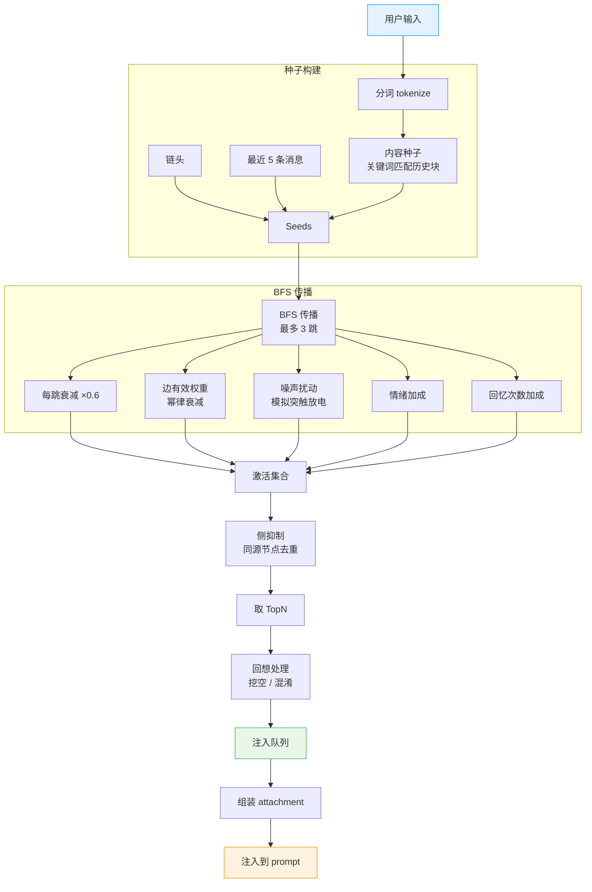
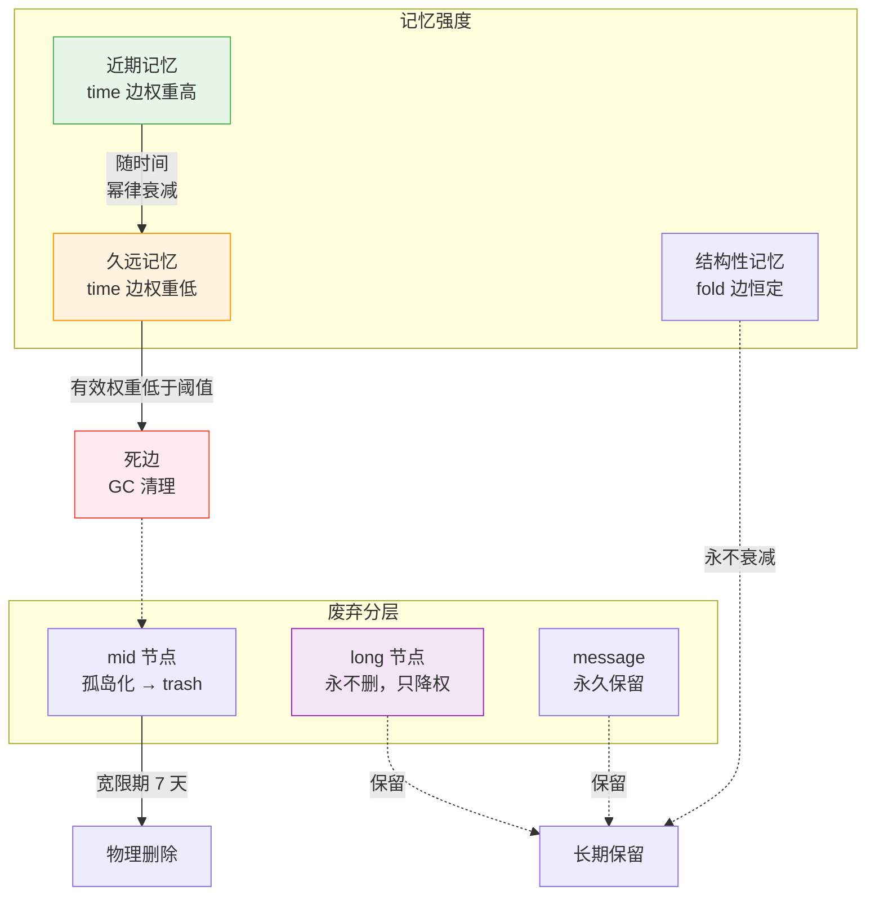
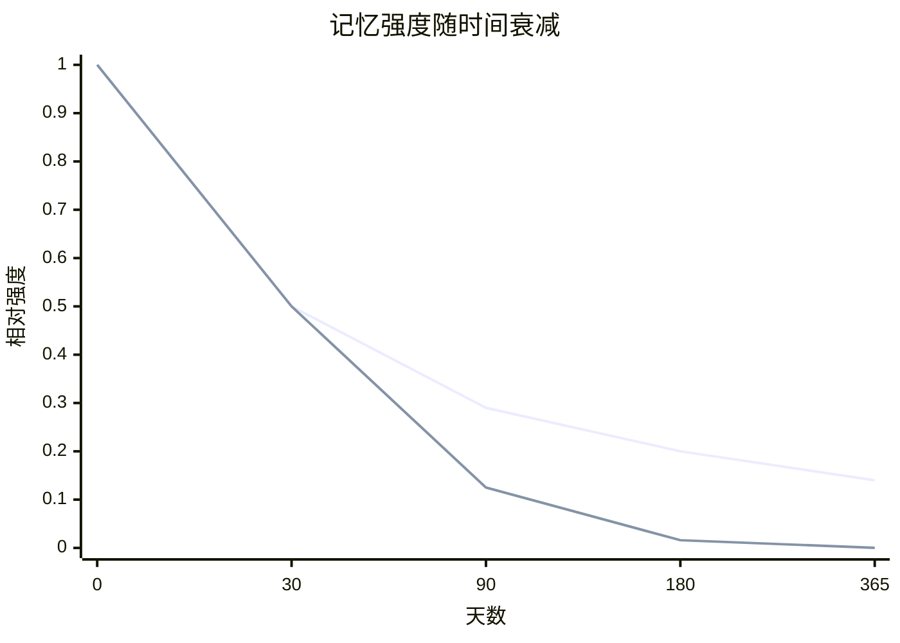
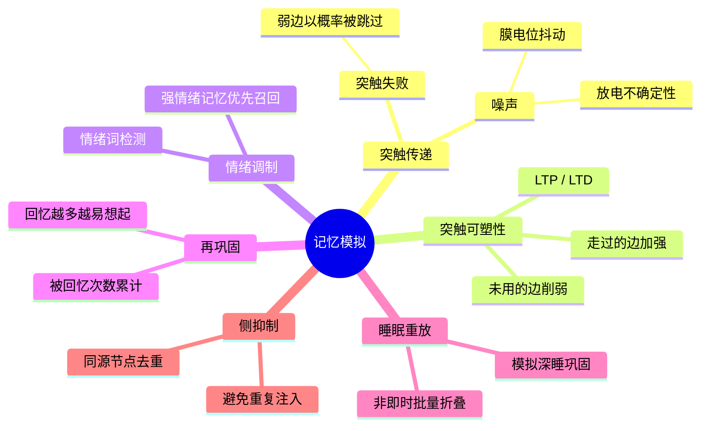
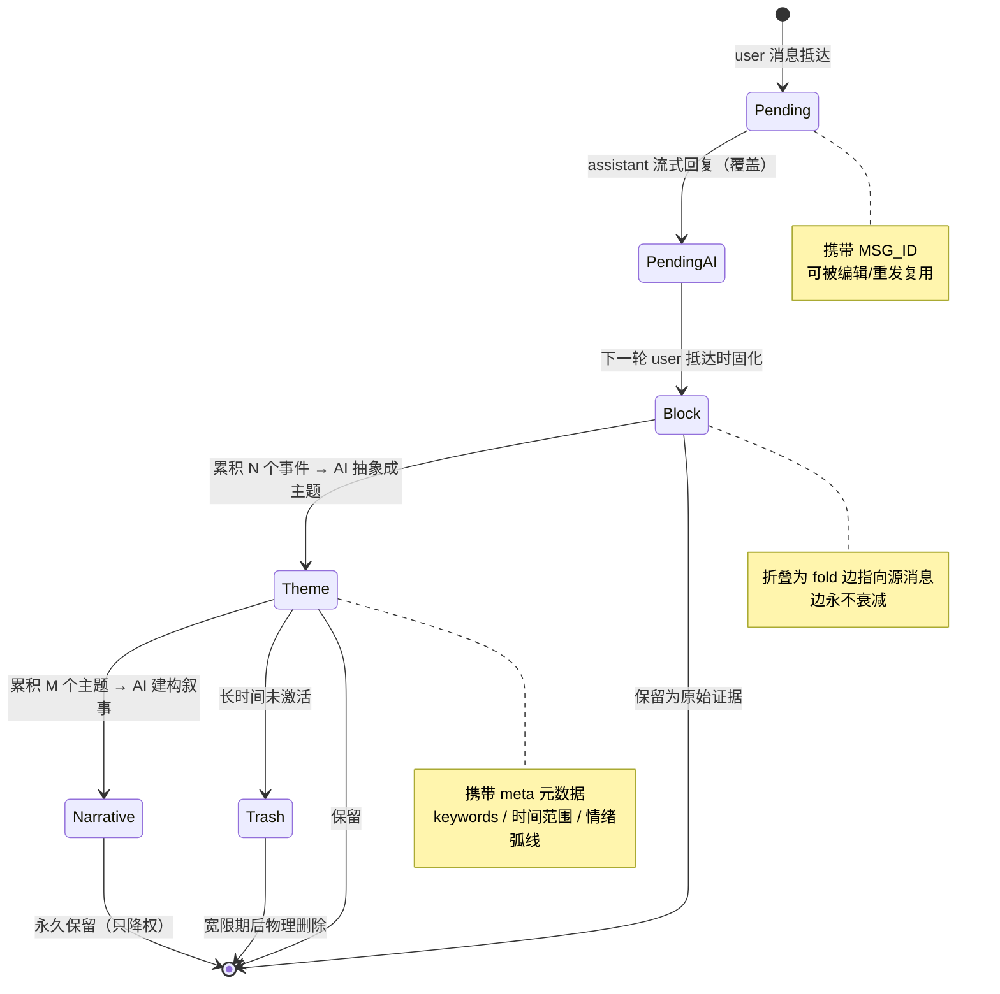

# OverMem | 旧忆重逢

    </img> 
    <i>*那些被遗忘的对话，终将再次被记起。*</i> 
    简体中文 | <a href="./doc/README.en.md">English</a>
      
    <a href="https://github.com/yyswys-yjyj/com.operit.overmem"></img></a>
    <a href="https://git.repo.archive.serveryyswys.top/yyswys-yjyj/com.operit.overmem"></img></a>
    </img>
    <a href="https://github.com/yyswys-yjyj/com.operit.overmem/LICENSE"></img></a>
    </img>

 

**当你和 AI 聊了许久，聊得久了，随着会话被压缩，AI 会慢慢淡忘你们之间的点点滴滴。**
**旧忆重逢** 是一个记忆库插件，旨在让 AI 记住你们的过去，助力守护着你们之间的回忆。

## 描述与架构设计

相信你在点进这个插件页面的那一刻，一定是为了寻找一个能让你和 AI 之间的回忆得以延续的解决方案。
OverMem 的方案基于一个根本性的认知：**真实的记忆不是档案柜，而是一张会随时间流动、重组、淡出的网**。

我们放弃了传统「线性表」的做法——那种把对话按时间顺序切成块，再逐级压缩的思路。取而代之的是一张**拓扑化的记忆网络**：每个对话片段是图中的一个节点，节点之间由三种边连接，形成一张可传播、可衰减、可重组的认知图。

AI 的回忆也因此变得生动：可能会忘记，可能会记错，有时候还会想不出来，但会在某个契机下突然灵光一现。

### 记忆系统的三层语义

OverMem 的三层记忆不是按「数量」分级，而是按**抽象层级**递进：

- **事件层**记录「发生了什么」
- **主题层**记录「反复出现的规律是什么」
- **叙事层**记录「这一切意味着什么」

三次抽象不是压缩，而是**视角切换**。同一个经历在三层里都有表示，检索时按输入的性质选择合适的一层。

### 记忆网络的拓扑结构

每一条消息、每一个事件块、每一份主题或叙事总结，都是网络中的一个**节点**。节点之间由三种**边**连接：

| 边 | 语义 | 衰减 |
|---|---|---|
| **time** | 时间上相邻的两条消息 | 幂律衰减（艾宾浩斯曲线） |
| **fold** | 高层节点折叠自低层节点 | 永不衰减（结构边） |
| **recall** | 长期记忆被回忆后回链到当前 | 幂律衰减（较慢） |

**关键设计**：
- 时间是单向的链，节点沿链排列，形成"记忆的时间轴"
- 折叠是自下而上的树，从原始对话逐步抽象为事件、主题、叙事
- 回忆是长期节点被想起时，与当前时刻建立的临时连接

## 完整数据流

下面这张时序图展示了一条用户消息从发送到记忆入库的完整过程：

**几个设计要点**：

1. **MSG_ID 是对话对的唯一标识**：每条 user 消息生成一个，无论后面有没有触发记忆检索，都会写入数据库。用途是让模型识别"同一轮对话"——用户编辑重发或重新生成 AI 回复时，attachment 中的 MSG_ID 保持不变。
2. **消息和记忆写入解耦**：即使当前没有可注入的记忆，user 也会正常入库。
3. **流式覆盖**：assistant 回复期间的每次 hook 都覆盖同一条 pending 记录，避免产生碎片。
4. **暂存区驱动**：整个写入依赖 `is_pending=1` 的标记，每轮新 user 到来时把上一轮固化。

## 记忆检索机制

检索不是 SQL 查询，而是**激活扩散**。从若干个"种子"出发，沿着网络中的边向外传播激活值，最终收集被激活最强的节点。

### 激活扩散的数学形式

从种子节点 $s$ 出发，第 $h$ 跳的激活值：

$$
\text{act}_{h+1}(t) = \text{act}_h(s) \cdot W_{\text{eff}}(e) \cdot \lambda^h \cdot \eta \cdot \beta_{\text{arousal}} \cdot \beta_{\text{recall}}
$$

其中：

- $W_{\text{eff}}(e)$ —— 边的有效权重（幂律衰减后）
- $\lambda = 0.6$ —— 每跳衰减系数
- $\eta \sim \text{jitter}$ —— 噪声扰动
- $\beta_{\text{arousal}}$ —— 情绪加成
- $\beta_{\text{recall}}$ —— 回忆频率加成

## 遗忘与衰减

遗忘不是删除，而是**边的自然衰减**。每一段记忆的强度不写在节点上，而体现在它与网络其他部分的连接强度上。

**幂律衰减曲线**（对比指数衰减）：

幂律曲线尾部更长——这就是为什么"老了还记得童年的事"，而指数衰减在半年后就把记忆压死了。

## 生物启发的机制

OverMem 不只是一个数据库，更是一次对神经机制的工程模拟。以下机制贯穿整个系统：

每一项机制都对应一个真实的生物学现象，也对应一段可以调整参数的配置。

## 消息的完整生命周期

## 最新动态

Beta 0.3.0 发布！   
时隔许久，对0.2.0进行的全面修复！    
如果您在测试使用的时候有任何问题，欢迎提交 issue。   

## 安装与使用

在 Operit AI 的插件市场中安装本包后，回到主页，找到侧栏的"OverMem 记忆库"入口，点击进入完成配置即可使用。

## 开源

该项目基于 GNU General Public License v3.0 (GPL-3.0) 协议开源。
开源仓库：[https://github.com/yyswys-yjyj/com.operit.overmem](https://github.com/yyswys-yjyj/com.operit.overmem)

## Star History

> 如果你喜欢这个项目，请到 Github 上给它一个 Star ⭐，谢谢

## Contributors

