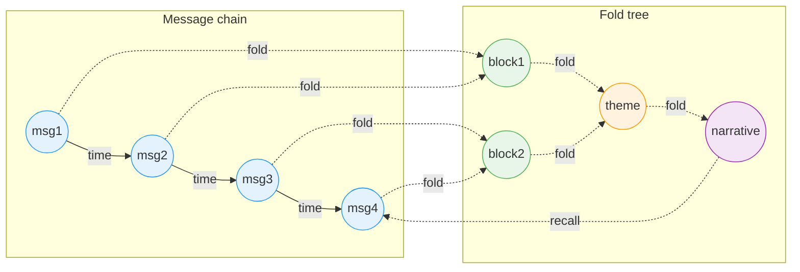
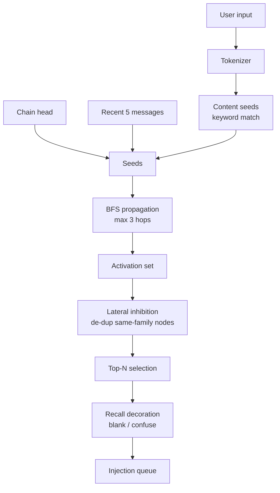

# OverMem | Reunion of Old Memories

<div align="center">
    </img><br>
    <i>*Those forgotten dialogues will eventually be remembered again.*</i><br>
    <a href="../README.md">简体中文</a> | English
    <br><br>
    <a href="https://github.com/yyswys-yjyj/com.operit.overmem"></img></a>
    <a href="https://git.repo.archive.serveryyswys.top/yyswys-yjyj/com.operit.overmem"></img></a>
    </img>
    <a href="https://github.com/yyswys-yjyj/com.operit.overmem/LICENSE"></img></a>
    </img>
</div>
<br>

**When you chat with an AI long enough, the conversation gets compressed, and the AI gradually forgets the little moments between you.**
**Reunion of Old Memories** (OverMem) is a memory-bank plugin that gives an AI a biologically-inspired long-term memory system.

> This README is aimed at **developers**. For end-user documentation, see the [Chinese README](../README.md) or the [user guide](https://doc.xclcs.top/9408796m0).

## Design Philosophy

OverMem rejects the conventional "linear table + progressive compression" approach. A real memory is not a filing cabinet — it is a **network that drifts, reorganizes, and fades over time**.

The system models memory as a **topological graph**:

- Every message, event block, theme, and narrative summary is a **node**
- Nodes are connected by three kinds of **edges**
- Retrieval is not a SQL query but **spreading activation**
- Forgetting is not deletion but **edge decay**

## Architecture

### Three-Layer Semantics

The three layers are **abstraction levels**, not quantity tiers:

| Layer | Node type | Answers |
|---|---|---|
| **Event** (short) | `block` | *What happened?* |
| **Theme** (mid) | `summary` with `level='mid'` | *What pattern keeps recurring?* |
| **Narrative** (long) | `summary` with `level='long'` | *What does it all mean?* |

Each layer is a **view** of the same underlying network, produced by LLM abstraction guided by JSON schemas.

### Memory Network Topology



| Edge type | Semantics | Decay |
|---|---|---|
| `time` | Adjacent messages in chronological order | Power-law (Ebbinghaus) |
| `fold` | Higher layer folded from lower layer | Never (structural) |
| `recall` | Long-term node re-attached to the present | Power-law (slower) |

## Data Model

Four SQLite tables in `mem.db` (shared with the Android companion app):

### `nodes`

Stores every message, event block, theme, and narrative.

```sql
CREATE TABLE nodes (
  id                INTEGER PRIMARY KEY AUTOINCREMENT,
  node_type         TEXT NOT NULL,       -- message | block | summary
  scope_type        TEXT NOT NULL,       -- session | role_card | global
  scope_id          TEXT NOT NULL,
  session_id        TEXT NOT NULL,
  role              TEXT DEFAULT '',     -- user | assistant (for messages)
  level             TEXT DEFAULT '',     -- short | mid | long (for summaries)
  content           TEXT NOT NULL,
  timestamp         INTEGER NOT NULL,
  created_at        INTEGER NOT NULL,
  updated_at        INTEGER NOT NULL,
  trashed_at        INTEGER DEFAULT NULL,
  msg_id            TEXT DEFAULT '',     -- conversation-pair ID
  seq               INTEGER DEFAULT 0,
  is_pending        INTEGER DEFAULT 0,   -- staging area flag
  arousal           REAL DEFAULT 0,      -- emotional intensity 0.0–1.0
  recalled_count    INTEGER DEFAULT 0,
  last_recalled_at  INTEGER DEFAULT 0,
  meta              TEXT DEFAULT ''      -- JSON metadata
);
```

The `meta` column carries structured LLM output:

- **Theme meta**: `{ type: "theme", title, keywords, timeStart, timeEnd, emotionalArc, recurringPatterns }`
- **Narrative meta**: `{ type: "narrative", title, chapters, characterArc, relationshipEvolution, longTermPatterns }`

### `edges`

```sql
CREATE TABLE edges (
  id              INTEGER PRIMARY KEY AUTOINCREMENT,
  from_node       INTEGER NOT NULL,
  to_node         INTEGER NOT NULL,
  edge_type       TEXT NOT NULL,     -- time | fold | recall
  weight          REAL DEFAULT 1.0,
  last_active_at  INTEGER NOT NULL,
  created_at      INTEGER NOT NULL
);
```

### `chain_meta`

Per-scope chain cursor (head/tail node, message count).

### `injection_log`

Idempotency guard for memory injection — the same `(message_id, node_id)` pair is only counted once.

## Retrieval Algorithm

Retrieval is **spreading activation** over the graph, not a query.



### Activation formula

For a hop `h` from seed `s` to node `t` through edge `e`:

$$
\text{act}_{h+1}(t) = \text{act}_h(s) \cdot W_{\text{eff}}(e) \cdot \lambda^h \cdot \eta \cdot \beta_{\text{arousal}} \cdot \beta_{\text{recall}}
$$

Where:

- $W_{\text{eff}}(e)$ — effective edge weight after decay
- $\lambda = 0.6$ — hop decay coefficient
- $\eta \sim \text{jitter}$ — Gaussian noise (synaptic firing uncertainty)
- $\beta_{\text{arousal}} = 1 + \text{arousal} \cdot 0.5$
- $\beta_{\text{recall}} = 1 + \log(1 + \text{recalledCount}) \cdot 0.15$

### Power-law decay

Unlike conventional exponential decay, OverMem uses a **power-law curve** (Ebbinghaus):

$$
W_{\text{eff}}(t) = w \cdot \left(1 + \frac{\text{ageDays}}{\tau}\right)^{-\beta}, \quad \beta = 0.4
$$

Comparison at `halfLife = 30 days`:

| Age | Exponential | Power-law |
|---|---|---|
| 30 d | 0.50 | 0.50 |
| 90 d | 0.125 | **0.29** |
| 180 d | 0.016 | **0.20** |
| 365 d | 0.0002 | **0.14** |

The long tail is why "you still remember your childhood" — a memory from a year ago still retains ~14% of its relative strength.

## Biological Mechanisms Simulated

| Mechanism | Implementation |
|---|---|
| **Synaptic transmission failure** | Weak edges are skipped with probability `0.7 + 0.3 · effWeight` |
| **Membrane potential jitter** | Gaussian multiplicative noise on every propagation |
| **Synaptic plasticity (LTP/LTD)** | Edges on injected paths are strengthened (+0.1); unused edges decay (-0.01) |
| **Emotional modulation** | Keyword-based `arousal` score boosts high-emotion nodes |
| **Reconsolidation** | `recalledCount` accumulates; frequently-recalled nodes get a log boost |
| **Sleep replay** | Periodic batch consolidation of mid → long, gated by `replayIntervalMs` |
| **Lateral inhibition** | Same-fold-family nodes de-duplicated in the top-N selection |

## Module Structure

```
src/
├── db/
│   ├── DatabaseManager.ts    # Connection lifecycle + config
│   ├── NodeManager.ts        # CRUD on nodes, staging area
│   ├── EdgeManager.ts        # Edge CRUD, power-law decay
│   ├── Schema.ts             # Declarative table definitions
│   └── Migration.ts          # v3 → v4 migration + diagnostics
├── memory/
│   ├── ShortTerm.ts          # Message → pending → block
│   ├── MidTerm.ts            # Block → theme (LLM + JSON schema)
│   ├── LongTerm.ts           # Theme → narrative + sleep replay
│   ├── ChainWalker.ts        # Spreading activation
│   ├── MemoryInjector.ts     # Multi-path recall + lateral inhibition
│   └── GarbageCollector.ts   # Dead edge / orphan mid cleanup
├── utils/
│   ├── MsgId.ts              # Conversation-pair ID generation
│   ├── Tokenizer.ts          # segmentit wrapper
│   ├── Emotion.ts            # Arousal detection
│   ├── Random.ts             # Jitter and Bernoulli helpers
│   └── JSONExtractor.ts      # Fault-tolerant JSON parsing
└── main.ts                   # Hook registration
```

## Hooks Used

| Hook | Purpose |
|---|---|
| `registerPromptInputHook` | Inject MSG_ID + memory attachment before prompt assembly |
| `registerMessageProcessingPlugin` | Persist user message, finalize previous turn |
| `registerChatMessageHook` | Stream-overwrite assistant pending message |

**Critical constraint**: ToolPkg hooks run in isolated JS environments. Java objects (including SQLite connections) are garbage-collected between hooks. Every hook must call `db.reopen()` at entry — a stale `SQLiteDatabase` reference will throw `already-closed`.

## Configuration

All settings live in the `config` table and mirror `OverMemConfig` (TypeScript) ↔ `ConfigCodec` (Kotlin).

Key parameters:

| Group | Parameter | Default | Meaning |
|---|---|---|---|
| Threshold | `midThreshold` | 40 | Events needed to trigger theme generation |
| | `longThreshold` | 20 | Themes needed to trigger narrative generation |
| Injection | `injectTopN` | 5 | Max memories injected per turn |
| Noise | `noiseTemperature` | 0.3 | Jitter amplitude |
| | `synapticFailureEnabled` | true | Stochastic edge skipping |
| Decay | `timeEdgeDecayDays` | 30 | time edge half-life |
| | `recallEdgeDecayDays` | 60 | recall edge half-life |
| | `edgeDeathThreshold` | 0.05 | GC threshold |
| Replay | `replayIntervalMs` | 6h | Minimum interval between replays |
| | `replayMinBatch` | 5 | Minimum unfolded themes to trigger |

## Development Setup

```bash
# TypeScript plugin
cd Overmem
npm install
./build.bat          # tsc + xcopy vendor

# Android companion
cd Overmem/app
./gradlew assembleDebug
adb install -r app/build/outputs/apk/debug/app-debug.apk
```

The Android app reads `mem.db` from `/storage/emulated/0/Download/Operit/overmem/` — the same file the plugin writes to. Both must stay schema-compatible.

## Installation (End Users)

Install from the Operit AI plugin marketplace, then open the sidebar entry "OverMem Memory Bank".

User guide: [https://doc.xclcs.top/9408796m0](https://doc.xclcs.top/9408796m0)

## License

GNU General Public License v3.0 (GPL-3.0).
Repository: [https://github.com/yyswys-yjyj/com.operit.overmem](https://github.com/yyswys-yjyj/com.operit.overmem)

## Star History


> If you like this project, please give it a Star ⭐ on GitHub.

## Contributors

<a href="https://github.com/yyswys-yjyj/com.operit.overmem/graphs/contributors">
  
</a>